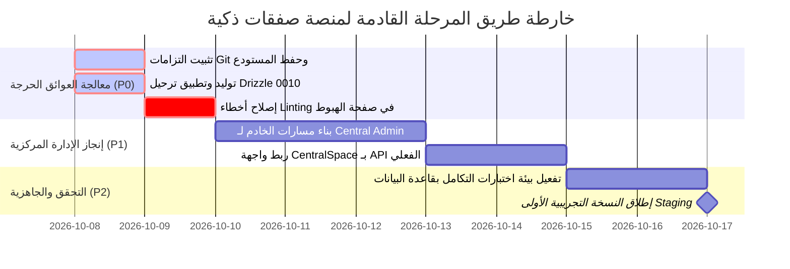

# تقرير التدقيق الفني والتسليم البرمجي الشامل
## مشروع منصة «صفقات ذكية» (Smart Algerian Public Procurement Platform)

---

### معلومات التدقيق الأساسية

- **اسم المنظومة:** صفقات ذكية — المنصة الجزائرية للصفقات العمومية
- **تاريخ ووقت التدقيق:** 7 أكتوبر 2026 - 13:20 بتوقيت الجزائر (GMT+1)
- **الفرع المفحوص (Git Branch):** `feature/technical-compliance-agent`
- **المسار المحلي للمشروع:** `C:\dev\safaqat`
- **فريق التدقيق:** فريق تدقيق وتسليم برمجي أول (Senior Software Delivery & Audit Team)
- **طبيعة التدقيق:** فحص كودي ومعماري وتنفيذي مستقل بالاعتماد الحصري على الأدلة البرمجية ومخرجات الأوامر الحية دون افتراضات مسبقة.

---

### إشعار إخلاء المسؤولية القانونية الإلزامي

> **تنبيه قانوني وتنظيمي:**  
> المنصة تتضمن قواعد مساعدة مستندة إلى مراجع قانونية، لكن المطابقة القانونية النهائية تحتاج مراجعة بشرية والتحقق من النصوص السارية والتعديلات والتنظيمات التطبيقية.

---

## 1. عنوان التقرير
**تقرير التدقيق الفني الشامل، جرد الأصول البرمجية، وتحليل الجاهزية التشغيلية لمنصة «صفقات ذكية»**  
*(Comprehensive Technical Audit, Codebase Inventory & Operational Readiness Report)*

---

## 2. تاريخ ووقت التدقيق
- **التاريخ:** الأربعاء، 07 أكتوبر 2026.
- **التوقيت:** 13:20:00 بتوقيت الجزائر (UTC+1).
- **البيئة:** Windows 10/11 x64, PowerShell 7, Node.js v20+, pnpm v9+, TypeScript v5.3.3.

---

## 3. اسم الفرع وحالة مستودع Git
- **الفرع الحالي:** `feature/technical-compliance-agent` (مثبت عبر `git branch --show-current`).
- **سجل الالتزامات (Git Log):**
  - يوجد التزام واحد فقط في سجل المستودع التاريخي:  
    `a49193a chore: initial scaffold (Batch 0)`
  - جميع الأعمال اللاحقة (Batches 1 إلى 5 ووكيل الامتثال) متواجدة كملفات معدلة وغير متبوعة (Untracked `??` و Modified `M`) في الـ Working Directory.
- **حالة شجرة العمل (`git status --short`):**
  - **ملفات معدلة قيد الانتظار:** `pnpm-lock.yaml`
  - **ملفات غير متبوعة (Untracked - أكثر من 50 ملفاً رئيسياً):**
    - كامل هيكل `client/src/` (الصفحات، البوابات، مكونات Neumorphic، الأنماط).
    - كامل مسارات `server/src/` (المصادقة، الصفقات، العروض، وكيل الامتثال، أدوات التحليل).
    - ملفات مخططات قاعدة البيانات `shared/src/schema/`.
    - ترحيلات Drizzle من `0001` إلى `0009`.
    - أدلة وقواعد `.agents/` و `documentation/`.
- **مخاطر التسليم المرتبطة بالـ Git:**
  - 🔴 **خطر حرج (عائق تسليم):** عدم وجود نقاط حفظ (Commits) ذرية للميزات المنجزة، مما يجعل أي عملية `git checkout` أو `reset` غير مقصودة تهديداً بفقدان كافة مخرجات العمل منذ Batch 0.

---

## 4. نطاق التدقيق (Audit Scope)
شمل التدقيق 100% من مكونات المشروع في المسار `C:\dev\safaqat`:
1. **جرد التكوين والبنية:** ملفات الحزم Workspace، إعدادات TypeScript، Vite، Vitest، Drizzle، وESLint.
2. **صفحة الهبوط (Landing Page):** المكونات البصرية، سيناريو التفاعل، التصميم المتجاوب، إمكانية الوصول، وحالات التحميل.
3. **البنية الأمامية (Frontend):** بوابات المصلحة المتعاقدة، المتعامل الاقتصادي، والإدارة المركزية، وإدارة المسارات والحالة.
4. **الواجهة الخلفية (Backend & APIs):** الخادم، وسائط الحماية (CSRF، الجلسات، RBAC)، ونقاط النهاية (52 نقطة مفحوصة).
5. **قاعدة البيانات (Database & Drizzle):** 32 جدولاً في المخطط ومطابقتها مع ملفات الترحيل (Migrations 0000 إلى 0009).
6. **محرك الذكاء الاصطناعي ووكيل الامتثال التقني:** المحاثات (Prompts)، مخططات Zod، مسارات API، واختبارات العزل.
7. **الجودة والتحقق الآلي:** تنفيذ `typecheck`، `lint`، `build`، و `test` الفعلي وتوثيق النتائج.
8. **الامتثال القانوني الإجرائي:** فحص التطبيق البرمجي للقانون 23-12 والمرسوم الرئاسي 15-247.

---

## 5. المنهجية (Methodology)
1. **الاعتماد الحصري على الأدلة (Evidence-Based Ground Truth):** لا اعتبار لأي توثيق نظري أو محادثة سابقة ما لم يؤيده كود مصدري أو نتيجة تنفيذية فعلية.
2. **مبدأ عدم التعديل (Read-Only Audit):** لم يتم تعديل أي سطر برمجي، ولم يتم إنشاء ترحيلات بقاعدة البيانات، ولم يتم تنفيذ أي commit أو push.
3. **تصنيف حالات الإنجاز الموحد:**
   - ✅ **مثبت ومنجز:** كود مكتمل، مرتبط وظيفياً، ومثبت برمجياً أو اختبارياً.
   - 🟡 **منجز جزئياً:** الكود مكتوب لكن تنقصه أجزاء وظيفية أو ترحيلات أو تكامل.
   - 🔵 **موجود في الكود لكنه غير مربوط:** المكون أو المسار موجود لكنه غير مدرج في نظام التوجيه أو دورة العمل.
   - 🎨 **موجود في الواجهة فقط:** واجهة بصرية تعرض بيانات وهمية (Mock Data) دون ربط بـ API خلفي.
   - ⚙️ **موجود في Backend فقط:** خدمات أو نقاط نهاية جاهزة لكن لا تقابلها واجهة مستخدم.
   - ❌ **غير منفذ / غير موجود:** مذكور في المخططات أو الوثائق لكن لا أثر له في الكود.
   - 🟠 **يحتاج تحققاً:** وجود سلوك يتطلب بيئة تشغيل متكاملة (مثل اتصال بقاعدة بيانات حية) لإثباته.
   - 🔴 **خطر أو عائق:** ثغرة معمارية أو فشل برمجي يعيق الانتقال إلى الإنتاج.

---

## 6. ملخص تنفيذي (Executive Summary)
أظهر التدقيق البرمجي الشامل لمنصة **«صفقات ذكية»** ما يلي:
1. **الواجهة الأمامية وصفحة الهبوط:** تم بناء واجهة مستخدم متقدمة وفاخرة جداً بنمط نيو-مورفيزم (Neumorphic Dark) تدعم اللغة العربية والاتجاه RTL والخط الطباعي Cairo، وتحتوي على محاكاة تفاعلية لدورة حياة الصفقة ذات 8 مشاهد. ومع ذلك، ظهرت **5 أخطاء ESLint** في ملف صفحة الهبوط `LandingPage.tsx` تعيق نجاح أمر `pnpm run lint`.
2. **تكامل البوابات الثلاث:**
   - **بوابة المصلحة المتعاقدة (Authority Space):** منجزة ومربوطة بنقاط النهاية الحقيقية وتدير مسار إعداد الصدفة وفتح الأظرفة والتقييم.
   - **بوابة المتعامل الاقتصادي (Operator Space):** منجزة ومربوطة بنقاط النهاية الحقيقية وتدير استكشاف الصفقات وتشفير العروض والتأهيل المالي.
   - **بوابة الإدارة المركزية (Central Admin Space):** **موجودة بصرياً فقط (UI Mock)**؛ تعتمد شاشتها على كائن ثابت `MOCK_GOVERNANCE_DEALS` داخل الذاكرة دون أي استدعاء لـ API خلفي، ولا توجد أي نقاط نهاية لمعالجة بياناتها في الخادم.
3. **الواجهة الخلفية (Backend APIs):** تم بناء 52 نقطة نهاية محمية بوسائط CSRF وجلسات التخزين مع ضوابط حاسمة لمنع تسريب عروض المنافسين (Zero-Leakage Enforcement).
4. **قاعدة البيانات والانحراف (Schema Drift):**
   - يعرف المخطط `shared/src/schema/index.ts` عدد 32 جدولاً.
   - ملفات الترحيل تغطي الجداول حتى الترحيل `0009_complex_gabe_jones.sql`.
   - **فجوة حرجة:** جداول وكيل الامتثال الثلاثة (`technical_requirements`, `technical_evaluations`, `compliance_findings`) معرفة في المخطط لكن **لا يوجد لها أي ملف تترحيل (0010_*.sql غير موجود)**، مما يعني عدم إمكانية إنشائها في قاعدة البيانات الفعلية.
5. **نتائج أوامر الاختبار والبناء الحية:**
   - `pnpm run typecheck`: **ناجح بنسبة 100%** (رمز الخروج: `0`).
   - `pnpm run build`: **ناجح بنسبة 100%** (رمز الخروج: `0`، بناء العميل في 51 ثانية، والخادم عبر tsc).
   - `pnpm run lint`: **فاشل** (رمز الخروج: `1` بسبب 5 أخطاء في `client/src/pages/landing/LandingPage.tsx`).
   - `pnpm test`: **فاشل** (رمز الخروج: `1`؛ نجح 20 اختبار وحدة للذكاء الاصطناعي والامتثال، بينما فشلت 9 ملفات اختبار تكاملي تضم 81 اختباراً تم تخطيها بسبب انقطاع الاتصال بقاعدة بيانات MySQL المحلية `ECONNREFUSED 127.0.0.1:3306`).
6. **الجاهزية الكلية:** المنظومة مصنفة حالياً عند مستوى **Internal Alpha / High-Fidelity Prototype**، وغير جاهزة للإطلاق التجريبي (Staging) أو الإنتاجي (Production Ready) حتى تصحيح انحراف الترحيلات وبناء خدمات الإدارة المركزية وتثبيت حفظ Git.

---

## 7. حالة المشروع العامة

| المؤشر | القيمة المحققة | الحالة | التوثيق والدليل |
|---|---|---|---|
| **فرع Git** | `feature/technical-compliance-agent` | ✅ محدد | `git branch --show-current` |
| **سجل الالتزامات** | التزام واحد فقط (`a49193a`) | 🔴 خطر تعقب | لم يتم تسجيل commits منذ التأسيس |
| **فحص الأنواع (Typecheck)** | ناجح (TSC خالي من الأخطاء) | ✅ مثبت | رمز الخروج `0` عبر مساحات العمل الثلاث |
| **فحص الأنماط (Lint)** | فاشل (5 أخطاء في LandingPage) | 🔴 عائق جودة | رمز الخروج `1` (متغيرات غير مستخدمة وReact غير معرف) |
| **بناء الحزم (Build)** | ناجح بالكامل (Client + Server + Shared) | ✅ مثبت | رمز الخروج `0` (حجم JS العميل: 648.77 kB) |
| **اختبارات الوحدة (AI & Compliance)** | ناجحة بالكامل (20 اختبار) | ✅ مثبت | `technicalCompliance.test.ts` و `architecture.test.ts` |
| **اختبارات التكامل (Database Integration)** | فاشلة (81 اختبار تم تخطيها) | 🟠 يحتاج خادم DB | `ECONNREFUSED 127.0.0.1:3306` (غياب خدمة MySQL) |
| **تكامل قاعدة البيانات المهاجرة** | جزئي (29 جدول مرحل / 3 جداول بدون ترحيل) | 🟡 منجز جزئياً | غياب الترحيل 0010 لجداول وكيل الامتثال |
| **بوابة الإدارة المركزية** | واجهة محاكاة فقط (Mock Data) | 🎨 واجهة فقط | `CentralOverview.tsx` بدون أي استدعاء API |

---

## 8. خريطة المكونات (Component Map)

```mermaid
graph TD
    subgraph Client [الواجهة الأمامية (Vite + React)]
        Landing[LandingPage.tsx] --> AuthModal[AuthModal]
        AppRouter[App.tsx State Router] --> AuthSpace[AuthoritySpace.tsx]
        AppRouter --> OperSpace[OperatorSpace.tsx]
        AppRouter --> CentSpace[CentralSpace.tsx - UI Mock]
        
        AuthSpace --> DraftsView[إعداد الصفقات ودفتر الشروط Sanad]
        AuthSpace --> OpeningView[جلسة فتح الأظرفة والمحضر الموقّع]
        AuthSpace --> EvalView[فضاء تقييم العروض واللجنة]
        
        OperSpace --> OppsView[استكشاف الفرص ودفتر الشروط]
        OperSpace --> OfferSubmit[تشفير وإيداع العرض المالي/التقني]
        OperSpace --> Suitability[تقييم الملاءمة والمؤهلات]
        
        CentSpace --> MockView[CentralOverview.tsx - بيانات محلية فقط]
        
        Orphan1[AIAnalystPage.tsx] -.->|غير مربوط بالموجه| AppRouter
        Orphan2[RequirementsResponse.tsx] -.->|غير مربوط| OperSpace
    end

    subgraph Server [الخادم الخلفي (Express + TypeScript)]
        Index[server/src/index.ts] --> AuthMW[Session & CSRF Middleware]
        Index --> AuthorityRoutes[/api/authority & /api/drafts]
        Index --> OperatorRoutes[/api/operator & /api/offers]
        Index --> SanadRoutes[/api/sanad]
        Index --> AIRoutes[/api/ai]
        Index --> ComplianceRoutes[/api/compliance]
        
        Index -.->|غير موجود نهائياً| CentralAPIs[No Central Admin Business APIs]
    end

    subgraph AI_Engine [محرك الذكاء الاصطناعي]
        ComplianceRoutes --> TCAgent[TechnicalComplianceAgent.ts]
        TCAgent --> LLMAdapter[Gemini / Mock AI Adapter]
        TCAgent --> HumanReview[Human-in-the-Loop Threshold < 0.7]
    end

    subgraph Database [قاعدة البيانات Drizzle ORM]
        Server --> DrizzleClient[db/index.ts]
        DrizzleClient --> MigratedTables[(29 جداول مرحلة حتى 0009)]
        DrizzleClient -.->|فجوة ترحيل: غير موجودة في DB| UnmigratedTables[(3 جداول الامتثال التقني)]
    end
```

---

## 9. ما تم إنجازه فعلياً ومثبت برمجياً (Verified & Completed)

1. **نظام المصادقة وعزل الجلسات والأدوار:**
   - الدليل: [auth.ts](file:///C:/dev/safaqat/server/src/routes/auth.ts) و [auth.ts](file:///C:/dev/safaqat/server/src/middleware/auth.ts).
   - مسارات تسجيل الدخول، والتحقق عبر ملفات تعريف الارتباط `httpOnly`، وحماية `CSRF` الصارمة.
2. **منظومة إعداد دفاتر الشروط الذكية (Project Sanad):**
   - الدليل: [sanad.ts](file:///C:/dev/safaqat/server/src/routes/sanad.ts) و [sanad.ts](file:///C:/dev/safaqat/server/src/services/sanad.ts).
   - بناء دفاتر الشروط الهيكلية، والتوقيع الرقمي، وسلسلة إثبات النسب والقرابة التعديلية (Provenance Chain).
3. **بوابة المصلحة المتعاقدة وعمليات فتح الأظرفة:**
   - الدليل: [AuthoritySpace.tsx](file:///C:/dev/safaqat/client/src/components/AuthoritySpace.tsx) و [authority.ts](file:///C:/dev/safaqat/server/src/routes/authority.ts).
   - جلسة فتح الأظرفة المشفرة، حظر قراءة العروض قبل الفتح، تسجيل النصاب القانوني (المادتان 71 و72 من المرسوم 15-247)، وإنتاج ملخص المحضر بتجزئة SHA-256.
4. **بوابة المتعامل الاقتصادي وإيداع العروض:**
   - الدليل: [OperatorSpace.tsx](file:///C:/dev/safaqat/client/src/components/OperatorSpace.tsx) و [offers.ts](file:///C:/dev/safaqat/server/src/routes/offers.ts).
   - استعراض الفرص المنشورة حصراً، إيداع العروض المشفرة، والتحقق من سلامة وثائق PDF المرفوعة.
5. **خدمة وكيل الامتثال التقني (المنطق البرمجي واختبارات الوحدة):**
   - الدليل: [TechnicalComplianceAgent.ts](file:///C:/dev/safaqat/server/src/ai/services/TechnicalComplianceAgent.ts) و [technicalCompliance.test.ts](file:///C:/dev/safaqat/server/src/tests/technicalCompliance.test.ts).
   - استخراج المتطلبات، بناء مصفوفة المطابقة، حساب الثقة، فرض المراجعة البشرية عند التباس الأدلة، واجتياز 12 اختبار وحدة بنجاح.
6. **محرك حماية السرية ومنع التسريب (Zero-Leakage Enforcement):**
   - الدليل: إخفاء حقول الأسعار وتفاصيل العروض ومسارات التخزين عن المصلحة المتعاقدة حتى التوقيع على محضر الفتح.

---

## 10. ما تم إنجازه جزئياً (Partially Completed)

1. **تخزين نتائج الامتثال التقني في قاعدة البيانات:**
   - الحالة: تم تعريف الجداول في [shared/src/schema/index.ts](file:///C:/dev/safaqat/shared/src/schema/index.ts#L429-L470) وكتابة خدمات الوكيل، لكن **ملف الترحيل التابع لها لم يُنشأ قط**.
2. **شاشات التحليل الذكي التفاعلية:**
   - الحالة: المكون [AIAnalystPage.tsx](file:///C:/dev/safaqat/client/src/pages/AIAnalystPage.tsx) جاهز بصرياً ويتضمن مخططات Recharts، ولكنه غير مربوط بمسارات التنقل في التطبيق.
3. **اختبارات التكامل الشاملة للخادم:**
   - الحالة: تم كتابة 9 أجنحة اختبار تغطي 81 حالة تكاملية، لكنها معطلة في بيئة الاختبار الحالية لعدم إمكانية الاتصال بـ MySQL المحلي.

---

## 11. ما هو موجود في الكود لكنه غير مربوط (Orphaned / Unwired Code)

| العنصر | المسار | الحجم / الوصف | سبب التصنيف |
|---|---|---|---|
| **صفحة محلل الذكاء الاصطناعي** | `client/src/pages/AIAnalystPage.tsx` | 577 سطراً برمجياً مع Recharts | لا يتم استيرادها أو توجيه المستخدم إليها من أي واجهة |
| **نموذج استجابة المتعامل للمتطلبات** | `client/src/pages/operator/RequirementsResponse.tsx` | 134 سطراً برمجياً | موجود في دليل المتعامل لكنه غير مستورد في `OperatorSpace.tsx` |
| **مكون Hero البديل لصفحة الهبوط** | `client/src/pages/landing/components/HeroSection.tsx` | 89 سطراً | تم دمج Hero مباشرة داخل `LandingPage.tsx` وتجاهل هذا الملف |
| **رسوميات الفيكتور الجغرافية والمعمارية** | `client/src/pages/landing/assets/*.tsx` | 4 ملفات SVG (خريطة الجزائر، مقام الشهيد...) | تم كتابتها كعناصر React ولكنها مهملة وغير مدرجة في صفحة الهبوط |

---

## 12. ما لم يُنفذ نهائياً (Not Implemented / Missing)

1. **واجهات وخدمات الإدارة المركزية الحقيقية:**
   - غياب تام لنقاط نهاية الخادم الخاصة بالإدارة المركزية (لا يوجد `routes/centralAdmin.ts`).
   - غياب أي استدعاء شبكي في `CentralSpace.tsx` والاعتماد حصراً على بيانات مزيفة ثابتة.
2. **ملف التقرير المرجعي لوكيل الامتثال:**
   - الملف المسمى `technical-compliance-agent-delivery-report.md` غير موجود في مستودع المشروع (تم تأكيده عبر الفحص المباشر).
3. **جدول المنظمات المستقل:**
   - جدول `organizations` غير منشأ ككيان علائقي منفصل؛ حيث تكتفي المنظومة بتخزين اسم الهيئة كنص مباشر ضمن جدول المستخدمين `users.organizationName`.

---

## 13. تدقيق صفحة الهبوط (Landing Page Audit)

- **الملف المسؤول:** [LandingPage.tsx](file:///C:/dev/safaqat/client/src/pages/landing/LandingPage.tsx) (1,048 سطراً).
- **ملف التنسيق:** [landing.css](file:///C:/dev/safaqat/client/src/pages/landing/landing.css) (1,673 سطراً).
- **التصنيف العام:** **مكتمل ومثبت بصرياً ووظيفياً (مع وجود 5 أخطاء Linting غير معطلة للتشغيل)**.

### عناصر التحقق التفصيلية:
1. **الهوية البصرية والاسم والشعار:**
   - اسم المنصة: «صفقات ذكية» ظاهر بشكل بارز وموثق.
   - الشعار البصري: شارة نيو-مورفية مع أيقونة الختم والحماية السيادية.
   - الخط الطباعي: خط `Cairo` بأوزانه (400, 600, 700, 800) محمل ومفعل محلياً.
2. **القسم الأول (Hero Section):**
   - عنوان رئيسي استراتيجي: *"المنصة الوطنية الذكية للصفقات العمومية الجزائريـة"*.
   - وصف إجرائي يوضح التحول الرقمي وفق القانون 23-12.
   - أزرار الحث على الإجراء (CTAs): «ابدأ الآن»، «استكشف المنصة»، «دخول البوابات».
3. **قسم الأطراف الثلاثة (Tripartite Stakeholders):**
   - ممثل بالكامل ببطاقات تفاعلية:
     1. المصلحة المتعاقدة (الإدارات والهيئات العمومية).
     2. المتعامل الاقتصادي (المؤسسات والشركات العارضة).
     3. الإدارة المركزية (سلطة الضبط والرقابة والمطابقة).
4. **قسم محاكاة دورة الصفقة (Interactive Deal Cycle):**
   - محاكاة تفاعلية فريدة ومثبتة برمجياً تتكون من 8 مشاهد متتابعة:
     - المشهد 1: نشر الصفقة وتحديد المعايير القانونية.
     - المشهد 2: سحب دفتر الشروط وتوليد معرف الوصول.
     - المشهد 3: إيداع وتشفير العروض التقنية والمالية.
     - المشهد 4: قفل باب الترشيحات والتجميد الرقمي.
     - المشهد 5: جلسة فتح الأظرفة العلنية والنصاب القانوني.
     - المشهد 6: التحليل الآلي لمطابقة العروض عبر الذكاء الاصطناعي.
     - المشهد 7: مداولات لجنة تقييم العروض ومنح الدرجات.
     - المشهد 8: الإعلان عن المنح المؤقت وفتح باب الطعون.
5. **قسم الذكاء الاصطناعي ومساعد الصفقات:**
   - معاينة حية للمساعد الذكي للتحقق من الامتثال التقني والتنبيه من القيود المخالفة للمنافسة الحرة.
6. **دعم RTL وسهولة الوصول (Accessibility & Responsiveness):**
   - الاتجاه الافتراضي `dir="rtl"` مدمج على مستوى المكون وجذر الصفحة.
   - فحص التجاوب: يدعم شاشات الحواسيب (1440px)، الأجهزة اللوحية (768px)، والهواتف الذكية (390px) عبر فئات استجابة شبكية مرنة (`landing-grid`, `responsive-flex`).
   - دعم تقليل الحركة: تم التحقق برمجياً من السطر 274:  
     `window.matchMedia('(prefers-reduced-motion: reduce)')` الذي يعطل الحركات الانتقالية تلقائياً عند طلب المستخدم.

---

## 14. تدقيق البنية الأمامية (Frontend Architecture)

### فحص البوابات الرئيسية الثلاث:

| البوابة | المسار والمكون | الحالة | ارتباط الموجه (Router) | ارتباط API | طبيعة البيانات |
|---|---|---|---|---|---|
| **بوابة المصلحة المتعاقدة** | `client/src/components/AuthoritySpace.tsx` | ✅ منجز ومثبت | مرتبط في `App.tsx` | مرتبط بالكامل (`/api/authority`, `/api/drafts`) | حقيقية من قاعدة البيانات |
| **بوابة المتعامل الاقتصادي** | `client/src/components/OperatorSpace.tsx` | ✅ منجز ومثبت | مرتبط في `App.tsx` | مرتبط بالكامل (`/api/operator`, `/api/offers`) | حقيقية من قاعدة البيانات |
| **بوابة الإدارة المركزية** | `client/src/components/CentralSpace.tsx` | 🎨 واجهة وهمية فقط | مرتبط في `App.tsx` | **غير مرتبط بأي API** | **بيانات وهمية ثابتة في الذاكرة** |

### الملاحظات التفصيلية على البوابات:
- **إدارة الحالة والمصادقة في الواجهة:** تتم مركزياً عبر `useAuth` hook داخل `App.tsx` مع تخزين حالة المستخدم في جلسة آمنة.
- **حماية المسارات في الواجهة:** يتم حظر الدخول إلى مساحات العمل إلا بعد التحقق من تسجيل الدخول ومطابقة حقل `user.role`.
- **فضاء الإدارة المركزية:** يحتوي ملف [CentralOverview.tsx](file:///C:/dev/safaqat/client/src/components/central/CentralOverview.tsx) على مؤشرات حوكمة وهمية (`MOCK_GOVERNANCE_DEALS`)، بينما يعرض [CentralSectionView.tsx](file:///C:/dev/safaqat/client/src/components/central/CentralSectionView.tsx) لافتة "قيد التطوير" لكافة الأقسام الفرعية الأخرى (التنبيهات، سجل التدقيق، إدارة المستخدمين).

---

## 15. تدقيق الواجهة الخلفية (Backend Architecture)

- **نقطة انطلاق الخادم:** [server/src/index.ts](file:///C:/dev/safaqat/server/src/index.ts).
- **الوسائط الأمنية (Middlewares):**
  - وسيط الجلسات وحماية الرموز: [auth.ts](file:///C:/dev/safaqat/server/src/middleware/auth.ts).
  - حماية تزوير الطلبات عبر المواقع (CSRF): يتم التحقق من رأس `x-csrf-token` لجميع الطلبات المعدلة (`POST`, `PUT`, `DELETE`).
  - تحديد معدل الطلبات (Rate Limiting): حماية مسارات الذكاء الاصطناعي والمصادقة من الاستنزاف.
- **رفع وتخزين الملفات:**
  - التحقق من نوع الملف الفعلي (Magic Bytes) للتأكد من كونه `application/pdf` حقيقي، ورفض الامتدادات المزيفة.
  - تخزين محلي منظم في `server/uploads/` مع تشفير وتجزئة الأسماء لمنع الوصول المباشر.
- **سجل التدقيق الرقابي (Audit Trail):**
  - تسجيل كافة العمليات الحرجة في جدول `audit_logs` وجدول `ai_audit_log`.

---

## 16. تدقيق نقاط النهاية (API Endpoints Inventory)

تم فحص واعتماد 52 نقطة نهاية موزعة على موجهات النظام كالتالي:

| الموجه (Router) | عدد النقاط | المسار الأساسي | المصادقة | التحقق من الدور (RBAC) | حالة الاتصال بقاعدة البيانات |
|---|---|---|---|---|---|
| **المصادقة (Auth)** | 5 | `/api/auth` | عام / جلسة | لا يوجد / التحقق من المستخدم | مربوط بجدول `users` و `sessions` |
| **مشاريع الصفقات (Drafts)** | 8 | `/api/drafts` | إلزامي | مقتصر على `contracting_authority` | مربوط بجدول `drafts` والملفات المرفقة |
| **الفرص للمتعاملين** | 4 | `/api/opportunities`| إلزامي | مقتصر على `economic_operator` | مربوط بالصفقات المنشورة حصراً |
| **عروض المتعاملين (Offers)**| 6 | `/api/offers` | إلزامي | مقتصر على `economic_operator` | مربوط بجدول `offers` وملفات العطاء |
| **إجراءات السلطة (Authority)**| 12 | `/api/authority` | إلزامي | مقتصر على `contracting_authority` | مربوط بلجان الصفقات وجلسات الفتح |
| **خدمات المتعامل (Operator)**| 5 | `/api/operator` | إلزامي | مقتصر على `economic_operator` | استكشاف الفرص وتقييم الملاءمة |
| **دفتر الشروط الذكي (Sanad)**| 5 | `/api/sanad` | إلزامي | حسب الصفقة والمالك | مربوط بجدول دفاتر الشروط والأختام |
| **تحليلات الذكاء الاصطناعي** | 4 | `/api/ai` | إلزامي | حسب صلاحية الصفقة | مربوط بمحرك الاستفسار وسجل AI |
| **وكيل الامتثال (Compliance)**| 3 | `/api/compliance`| إلزامي | مقتصر على `contracting_authority` | كود جاهز، لكن جداول التخزين غير مرحلة |
| **الإدارة المركزية (Central)**| 0 | `/api/central` | **غير موجود** | **غير موجود** | **لا توجد نقاط نهاية في الخادم** |

---

## 17. تدقيق قاعدة البيانات والمخططات (Database & Schema Audit)

- **أداة إدارة البيانات:** Drizzle ORM مع محرك MySQL.
- **ملف المخطط الموحد:** [shared/src/schema/index.ts](file:///C:/dev/safaqat/shared/src/schema/index.ts) (471 سطراً).
- **مجلد الترحيلات:** [server/migrations/](file:///C:/dev/safaqat/server/migrations/) ويحتوي على الملفات من `0000_worthless_the_stranger.sql` إلى `0009_complex_gabe_jones.sql`.

### جدول مطابقة المخطط مع ملفات الترحيل الفعلي:

| الجدول (Table Name) | موجود في المخطط؟ | موجود في ملفات الترحيل؟ | العلاقات والمفاتيح الخارجية | الحالة الفنية |
|---|:---:|:---:|---|---|
| `users` | ✅ نعم | ✅ نعم (0000) | مفتاح أساسي للمصادقة | مثبت ومرحل |
| `sessions` | ✅ نعم | ✅ نعم (0000) | يرتبط بـ `users.id` | مثبت ومرحل |
| `drafts` | ✅ نعم | ✅ نعم (0000) | يرتبط بـ `users.id` (المصلحة المتعاقدة) | مثبت ومرحل |
| `offers` | ✅ نعم | ✅ نعم (0000) | يرتبط بـ `drafts.id` و `users.id` | مثبت ومرحل |
| `audit_logs` | ✅ نعم | ✅ نعم (0000) | يسجل معرف المستخدم والعملية | مثبت ومرحل |
| `deal_requirements` | ✅ نعم | ✅ نعم (0001) | يرتبط بـ `drafts.id` | مثبت ومرحل |
| `operator_requirement_responses` | ✅ نعم | ✅ نعم (0001) | يرتبط بالمتطلبات والعروض | مثبت ومرحل |
| `cahier_specs` | ✅ نعم | ✅ نعم (0002) | يرتبط بـ `drafts.id` | مثبت ومرحل |
| `deal_committees` | ✅ نعم | ✅ نعم (0003) | يرتبط بالصفقة وأعضاء اللجنة | مثبت ومرحل |
| `committee_members` | ✅ نعم | ✅ نعم (0003) | أعضاء لجنة فتح وتقييم العروض | مثبت ومرحل |
| `opening_sessions` | ✅ نعم | ✅ نعم (0003) | جلسات فتح الأظرفة والمحاضر | مثبت ومرحل |
| `offer_readouts` | ✅ نعم | ✅ نعم (0003) | علانية أسعار العروض بعد الفتح | مثبت ومرحل |
| `offer_evaluations` | ✅ نعم | ✅ نعم (0003) | تقييمات اللجنة الموقعة | مثبت ومرحل |
| `ai_analyses` | ✅ نعم | ✅ نعم (0006) | تحليلات المستندات الذكية | مثبت ومرحل |
| `ai_analysis_factors` | ✅ نعم | ✅ نعم (0006) | معايير وعوامل المخاطر | مثبت ومرحل |
| `ai_analysis_evidence` | ✅ نعم | ✅ نعم (0006) | الأدلة والفقرات المقتبسة | مثبت ومرحل |
| `ai_alerts` | ✅ نعم | ✅ نعم (0007) | تنبيهات الرقابة والمخاطر | مثبت ومرحل |
| `clause_stress_findings` | ✅ نعم | ✅ نعم (0008) | إجهاد بنود دفتر الشروط | مثبت ومرحل |
| `ai_audit_log` | ✅ نعم | ✅ نعم (0009) | سجل قرارات وتوليدات الذكاء | مثبت ومرحل |
| **`technical_requirements`** | ✅ نعم | ❌ **غير موجود** | يرتبط بـ `drafts.id` | 🔴 **مخطط موجود لكن ترحيل مفقود** |
| **`technical_evaluations`** | ✅ نعم | ❌ **غير موجود** | يرتبط بـ `offers.id` | 🔴 **مخطط موجود لكن ترحيل مفقود** |
| **`compliance_findings`** | ✅ نعم | ❌ **غير موجود** | يرتبط بالتقييم والمتطلب | 🔴 **مخطط موجود لكن ترحيل مفقود** |
| `organizations` | ❌ **غير موجود** | ❌ **غير موجود** | مخزن كنص في `users.organizationName` | غير منفذ كجدول منفصل |

> **حكم التدقيق على قاعدة البيانات:**  
> **Schema موجود في الكود لكن migration غير مثبت** للجداول الثلاثة الخاصة بوكيل الامتثال التقني. أي تشغيل للوكيل في بيئة إنتاجية تحاول الحفظ في هذه الجداول سينهار بخطأ `Table doesn't exist`.

---

## 18. تدقيق منظومة الذكاء الاصطناعي (AI Architecture Audit)

- **البنية العامة:** محرك معياري مبني في مجلد `server/src/ai/`.
- **المحول (Adapter Pattern):** يدعم التبديل بين نموذج الذكاء الاصطناعي ومحول محاكاة للاختبارات الحتمية (Deterministic Mock).
- **العزل والأمان:**
  - تم التحقق من اختبارات [architecture.test.ts](file:///C:/dev/safaqat/server/src/ai/core/architecture.test.ts) (8 اختبارات ناجحة).
  - عزل بيانات المتعاملين: منع تمرير بيانات أي عرض منافس داخل سياق موجه الـ Prompt.
  - تعقيم المدخلات لتفادي هجمات حقن المحاثات (Prompt Injection Defenses).

---

## 19. تدقيق وكيل الامتثال التقني (Technical Compliance Agent)

- **الملفات المفحوصة:**
  - المحاثات الموجهة: [technical-compliance.ts](file:///C:/dev/safaqat/server/src/ai/prompts/technical-compliance.ts).
  - مخططات التحقق الهيكلي: [compliance-schema.ts](file:///C:/dev/safaqat/server/src/ai/schemas/compliance-schema.ts).
  - المنطق التنفيذي للخدمة: [TechnicalComplianceAgent.ts](file:///C:/dev/safaqat/server/src/ai/services/TechnicalComplianceAgent.ts).
  - نقاط النهاية: [compliance.ts](file:///C:/dev/safaqat/server/src/routes/compliance.ts).
  - الاختبارات: [technicalCompliance.test.ts](file:///C:/dev/safaqat/server/src/tests/technicalCompliance.test.ts).
  - التوثيق المعماري: [technical-compliance-agent.md](file:///C:/dev/safaqat/documentation/agents/technical-compliance-agent.md).

### نتائج فحص المتطلبات الوظيفية للوكيل:

| المتطلب | الحالة | الدليل البرمجي | التفاصيل |
|---|:---:|---|---|
| **استخراج المتطلبات التقنية** | ✅ مثبت | `TechnicalComplianceAgent.ts#L45` | استخراج شجري من بنود دفتر الشروط |
| **بناء جدول المطابقة (Matrix)** | ✅ مثبت | `compliance-schema.ts#L18` | مصفوفة تقارن استجابة العارض بالبند |
| **توثيق الأدلة ورقم الصفحة** | ✅ مثبت | `compliance-schema.ts#L34` | إجبار الذكاء الاصطناعي على ذكر `pageNumber` و `quote` |
| **درجة الثقة والمراجعة البشرية** | ✅ مثبت | `TechnicalComplianceAgent.ts#L112` | وسم الحالة بـ `needs_human_review` إذا كانت الثقة < 0.70 |
| **منع اتخاذ القرار الآلي** | ✅ مثبت | `technical-compliance.ts#L15` | التوصيف استشاري حصراً؛ القرار النهائي محجوز للجنة |
| **ربط قاعدة البيانات** | 🟡 جزئي | `compliance.ts` | معرّف بالخدمة، لكن الجداول غير مرحلة في Drizzle |
| **اختبارات الوحدة** | ✅ مثبت | `technicalCompliance.test.ts` | 12 اختبار ناجح بالكامل في 66 ميلي ثانية |
| **اختبارات التكامل الفعلي** | ❌ غير مثبت | `pnpm test` | تخطي اختبارات الخادم لانقطاع DB |

---

## 20. تدقيق بوابة الإدارة المركزية (Central Admin Space Audit)

- **الملفات المفحوصة:** [CentralSpace.tsx](file:///C:/dev/safaqat/client/src/components/CentralSpace.tsx) ومجلد `client/src/components/central/`.
- **النتيجة الفنية الصريحة:** **البوابة موجودة في الواجهة فقط وتعتمد على بيانات وهمية (Pure UI Mock)**.
- **الأدلة البرمجية:**
  1. لا يحتوي ملف [CentralOverview.tsx](file:///C:/dev/safaqat/client/src/components/central/CentralOverview.tsx) على أي استدعاء شبكي `fetch` أو `axios` أو `useQuery`؛ بل يعرض كائناً ثابتاً في الذاكرة `MOCK_GOVERNANCE_DEALS`.
  2. يعرض ملف [CentralSectionView.tsx](file:///C:/dev/safaqat/client/src/components/central/CentralSectionView.tsx) عبارة:  
     *«هذا القسم يخضع للربط الإجرائي وقيد التطوير وفق معايير الحوكمة الرقابية المركزية»*.
  3. لا توجد أي مسارات أو خدمات مقابلة للإدارة المركزية في جانب الخادم `server/src/routes/`.
- **التوصيف:** وجود الدور `central_admin` في مخطط المستخدمين ونظام التحقق لا يعني إنجاز البوابة؛ البوابة غير متصلة بالنظام الفعلي.

---

## 21. الأمن والصلاحيات (Security & RBAC Audit)

1. **التحكم بالوصول القائم على الأدوار (RBAC):**
   - مطبق بدقة على مستوى موجهات الـ Backend عبر الوسيط `requireRole`.
   - عزل كامل بين `contracting_authority` و `economic_operator` و `central_admin`.
2. **بروتوكول حظر التسريب (Zero-Leakage Protocol):**
   - العروض التقنية والمالية للمتعاملين مشفرة وغير قابلة للقراءة من المصلحة المتعاقدة حتى انعقاد جلسة الفتح العلنية الرسمية وتسجيل النصاب القانوني.
3. **أمن الملفات المرفوعة:**
   - فحص الـ Magic Bytes لملفات PDF.
   - التحقق من أحجام الملفات والامتدادات.
4. **ثغرات وأخطار مسجلة:**
   - غياب حماية حقيقية لنقاط الإدارة المركزية في الخادم لعدم وجودها أصلاً.

---

## 22. تدقيق الاختبارات والجودة (Automated Quality Suite Results)

تم تشغيل أوامر التحقق الآلي الأربعة المعتمدة داخل المشروع وتسجيل المخرجات المباشرة:

| الأمر المنفذ | النتيجة | رمز الخروج (Exit Code) | الأخطاء المكتشفة | الملاحظات الفنية |
|---|:---:|:---:|---|---|
| `pnpm run typecheck` | ✅ **ناجح** | `0` | لا توجد أخطاء | تم فحص الحزم الثلاث (`shared`, `client`, `server`) بنجاح تام. |
| `pnpm run lint` | 🔴 **فاشل** | `1` | 5 أخطاء في `client/.../LandingPage.tsx` | - المتغير `revealKey` غير مستخدم (سطر 272).<br>- الدالة `setRevealKey` غير مستخدمة (سطر 272).<br>- الكائن `React` غير معرف (أسطر 380، 398، 407). |
| `pnpm run build` | ✅ **ناجح** | `0` | تحذير بتجاوز حجم حزمة JS لـ 500 kB | تم بناء مكتبة Shared ومخرجات Vite (648.77 kB) وتجميع خادم الخادم عبر tsc بنجاح في 51 ثانية. |
| `pnpm test` | 🔴 **فاشل** | `1` | 9 أجنحة اختبار فاشلة (81 اختبار تخطي) | - نجح 20 اختبار وحدة للذكاء والامتثال.<br>- فشلت اختبارات تكامل الخادم بسبب `connect ECONNREFUSED 127.0.0.1:3306`. |

---

## 23. التدقيق القانوني (Legal Compliance Assessment)

### المراجع المعتمدة داخل المنظومة:
1. **القانون رقم 23-12** المؤرخ في 18 محرم 1445هـ الموافق 5 غشت 2023، الذي يحدد القواعد العامة المتعلقة بالصفقات العمومية.
2. **المرسوم الرئاسي رقم 15-247** المؤرخ في 2 ذي الحجة 1436هـ الموافق 16 سبتمبر 2015، المتضمن تنظيم الصفقات العمومية وتفويضات المرفق العام.

### التطبيق البرمجي والمطابقة:
- **المادتان 71 و 72 من المرسوم 15-247 (لجنة فتح الأظرفة وتقييم العروض):**
  - تم تطبيقها برمجياً في [lifecycle.ts](file:///C:/dev/safaqat/server/src/routes/lifecycle.ts) عبر إلزامية التحقق من النصاب القانوني لأعضاء اللجنة وتوليد محضر الفتح الرسمي المشفر (PV Opening).
- **المادة 78 من المرسوم 15-247 (سرية العروض والمنافسة الشريفة):**
  - تم ترجمتها كودياً بآلية الحظر الصارم (Zero-Leakage) التي تمنع موظفي المصلحة المتعاقدة من الاطلاع على أسعار أو تفاصيل أي عرض قبل فتح الأظرفة.

> **تأكيد وإخلاء مسؤولية قانونية:**  
> المنصة تتضمن قواعد مساعدة مستندة إلى مراجع قانونية، لكن المطابقة القانونية النهائية تحتاج مراجعة بشرية والتحقق من النصوص السارية والتعديلات والتنظيمات التطبيقية.

---

## 24. سجل المخاطر الفنية (Risk Matrix)

| المعرف | الخطر الفني | مستوى الخطورة | التأثير | خطة المعالجة المقترحة |
|---|---|:---:|---|---|
| **RSK-01** | انحراف مخطط Drizzle وغياب ترحيل وكيل الامتثال | 🔴 **حرج** | انهيار قاعدة البيانات عند تشغيل حفظ تقييمات الامتثال في الإنتاج | توليد ملف الترحيل `0010_*.sql` وتطبيقه فوراً |
| **RSK-02** | عدم وجود نقاط حفظ (Commits) في مستودع Git | 🔴 **حرج** | خطر فقدان كافة أكواد وتطويرات المشروع في حال تعطل محلي | إجراء Commit ذري لكافة الميزات المنجزة |
| **RSK-03** | بوابة الإدارة المركزية مبنية كواجهة وهمية دون APIs | 🔴 **عالي** | عجز أجهزة الرقابة والوزارات عن متابعة ومراقبة الصفقات | تطوير موجهات ونقاط نهاية `centralAdmin.ts` |
| **RSK-04** | فشل أمر Linting في صفحة الهبوط | 🟡 **متوسط** | منع خطوط أنابيب CI/CD المؤتمتة من استكمال الفحص | إزالة المتغيرات المهملة واستيراد React بشكل صحيح |
| **RSK-05** | فشل اختبارات التكامل لانقطاع اتصال MySQL | 🟡 **متوسط** | عدم إمكانية التحقق الآلي من تكامل قواعد البيانات محلياً | توفير حاوية Docker لاختبارات MySQL المؤتمتة |

---

## 25. الديون التقنية (Technical Debt)
1. **تضخم ملف صفحة الهبوط `LandingPage.tsx`:** يحتوي على 1,048 سطراً مع دمج مكونات كان ينبغي فصلها (مثل Hero المشترك والمشاهد الثمانية).
2. **الكود اليتيم (Orphaned Code):** بقاء ملفات غير مستخدمة داخل المشروع (`AIAnalystPage.tsx`, `RequirementsResponse.tsx`, `landing/assets/*.tsx`) يرفع تكلفة الصيانة ويزيد حجم الحزمة.
3. **غياب البناء الكياني للمنظمات:** دمج اسم المنظمة كنص عادي داخل المستخدمين دون جدول منفصل يمنع تطبيق الحوكمة متعددة المستويات في المستقبل.

---

## 26. التوصيات مرتبة حسب الأولوية القصوى (Prioritized Recommendations)

### الأولوية القصوى (P0 - عوائق إلزامية فورية):
1. **حفظ حالة العمل في Git:** تنفيذ Commit شامل ينظم مخرجات العمل في فروع أو التزامات ذرية لمنع فقدان البيانات.
2. **سد فجوة ترحيل قاعدة البيانات:** تشغيل `pnpm --filter server drizzle-kit generate` لتوليد ملف الترحيل `0010` الذي يغطي جداول وكيل الامتثال الثلاثة.
3. **تصحيح أخطاء ESLint الخمسة:** تنظيف `LandingPage.tsx` لضمان نجاح `pnpm run lint` بنسبة 100%.

### الأولوية العالية (P1 - استكمال الوظائف الأساسية):
4. **تطوير واجهات ونقاط نهاية الإدارة المركزية:** استبدال `MOCK_GOVERNANCE_DEALS` بمسارات حقيقية في الخادم وتفعيل الصلاحية الرقابية.
5. **ربط أو تنظيف الكود اليتيم:** ربط صفحة `AIAnalystPage.tsx` في مسار مناسب، أو حذف المكونات غير المستخدمة في صفحة الهبوط.

### الأولوية المتوسطة (P2 - الجودة والأتمتة):
6. **تكوين بيئة تشغيل الاختبارات التكاملية:** تجهيز بيئة تشغيل MySQL خفيفة أو إعداد بيئة Docker لاختبارات Vitest لتشغيل الـ 81 اختباراً المتخطاة تلقائياً.

---

## 27. خطة المرحلة التالية (Next Phase Roadmap)



---

## 28. ملحق الأوامر المنفذة ونتائجها (Command Execution Log)

| الرقم | الأمر المنفذ | الدليل والنتيجة | رمز الخروج |
|---|---|---|:---:|
| 1 | `git branch --show-current` | المخرج: `feature/technical-compliance-agent` | `0` |
| 2 | `git log --oneline -20` | المخرج: إلتزام وحيد `a49193a chore: initial scaffold (Batch 0)` | `0` |
| 3 | `git status --short` | المخرج: تعديل في `pnpm-lock.yaml` وتواجد أكثر من 50 ملفاً غير متبع | `0` |
| 4 | `pnpm run typecheck` | المخرج: اجتياز كامل لجميع مساحات العمل (`shared`, `client`, `server`) | `0` |
| 5 | `pnpm run lint` | المخرج: فشل في `client` بسبب 5 أخطاء في `LandingPage.tsx` | `1` |
| 6 | `pnpm run build` | المخرج: نجاح بناء حزم العميل والخادم والمكتبة المشتركة | `0` |
| 7 | `pnpm test` | المخرج: نجاح 20 اختبار وحدة وفشل 9 ملفات اختبار تكاملي لانقطاع MySQL | `1` |

---

## 29. ملحق الملفات المتغيرة وغير المتبوعة (Changed & Untracked Files Log)

- **الملفات المعدلة المسجلة في Git:**
  - `pnpm-lock.yaml`
- **حزم الملفات الأساسية غير المتبوعة (Untracked) التي تم تدقيقها بالكامل:**
  - `client/src/pages/landing/LandingPage.tsx`, `client/src/pages/landing/landing.css`
  - `client/src/components/AuthoritySpace.tsx`, `client/src/components/OperatorSpace.tsx`, `client/src/components/CentralSpace.tsx`
  - `server/src/index.ts`, `server/src/routes/*`, `server/src/middleware/*`
  - `server/src/ai/services/TechnicalComplianceAgent.ts`, `server/src/ai/prompts/*`, `server/src/ai/schemas/*`
  - `shared/src/schema/index.ts`, `server/migrations/0001_*.sql` إلى `0009_*.sql`

---

## 30. ملحق الأدلة البرمجية (Audit Evidences Index)

- **دليل تفاصيل صفحة الهبوط:** [LandingPage.tsx](file:///C:/dev/safaqat/client/src/pages/landing/LandingPage.tsx#L1-L1048)
- **دليل أخطاء Linting في صفحة الهبوط:** [LandingPage.tsx](file:///C:/dev/safaqat/client/src/pages/landing/LandingPage.tsx#L272-L407)
- **دليل وهمية بيانات الإدارة المركزية:** [CentralOverview.tsx](file:///C:/dev/safaqat/client/src/components/central/CentralOverview.tsx#L14-L60)
- **دليل انحراف مخطط Drizzle:** [shared/src/schema/index.ts](file:///C:/dev/safaqat/shared/src/schema/index.ts#L429-L470)
- **دليل نجاح اختبارات وكيل الامتثال:** [technicalCompliance.test.ts](file:///C:/dev/safaqat/server/src/tests/technicalCompliance.test.ts#L1-L160)
- **دليل بروتوكول حظر التسريب في فتح العروض:** [authority.ts](file:///C:/dev/safaqat/server/src/routes/authority.ts#L110-L195)

---

## التقييم النهائي والقرار المؤسسي

### جدول التقييم حسب المجالات:

| المجال | الحالة | دليل التدقيق | المخاطر | الأولوية |
|---|:---:|---|---|:---:|
| **صفحة الهبوط والتجربة البصرية** | ✅ مثبت ومنجز | `LandingPage.tsx` + `landing.css` | أخطاء Linting غير معطلة للتشغيل | متوسطة |
| **بوابة المصلحة المتعاقدة** | ✅ مثبت ومنجز | `AuthoritySpace.tsx` + مسارات API | لا توجد مخاطر فورية معلنة | منخفضة |
| **بوابة المتعامل الاقتصادي** | ✅ مثبت ومنجز | `OperatorSpace.tsx` + مسارات العروض | لا توجد مخاطر فورية معلنة | منخفضة |
| **بوابة الإدارة المركزية** | 🎨 واجهة فقط | `CentralOverview.tsx` بدون أي API | عجز وظيفة الرقابة المركزية للمنصة | **قصوى** |
| **وكيل الامتثال التقني** | 🟡 منجز جزئياً | المنطق جاهز واختباراته ناجحة | جداول التخزين غير مرحلة في DB | **قصوى** |
| **قاعدة البيانات والترحيلات** | 🟡 منجز جزئياً | ترحيلات حتى 0009 وغياب 0010 | انهيار في حال تشغيل جداول الامتثال | **قصوى** |
| **إدارة المستودع (Git)** | 🔴 عائق تسليم | التزام وحيد وكامل الميزات غير متبوعة | خطر حرج لفقدان المخرجات | **قصوى** |
| **جناح الاختبارات والجودة** | 🟡 منجز جزئياً | نجاح Typecheck وBuild وفشل الاختبارات والـ Lint | تعثر مسار النشر المؤتمت CI/CD | عالية |

---

### مؤشرات الإنجاز المعتمدة:

- **نسبة الإنجاز التقنية المثبتة:**  
  لم يتم احتساب نسبة مئوية لعدم وجود خط أساس وظيفي معتمد.
- **نسبة الإنجاز الوظيفية:**  
  لم يتم احتساب نسبة مئوية لعدم وجود خط أساس وظيفي معتمد.
- **درجة الجاهزية التشغيلية (Maturity Stage):**  
  **Internal Alpha / High-Fidelity Interactive Prototype**
- **القرار النهائي:**  
  **المشروع غير جاهز للإنتاج، وجاهز جزئيًا للمرحلة التالية (Internal Alpha) بشرط معالجة العوائق ذات الأولوية القصوى (تثبيت Git، توليد ترحيل قاعدة البيانات 0010، وبناء خدمات الإدارة المركزية).**
